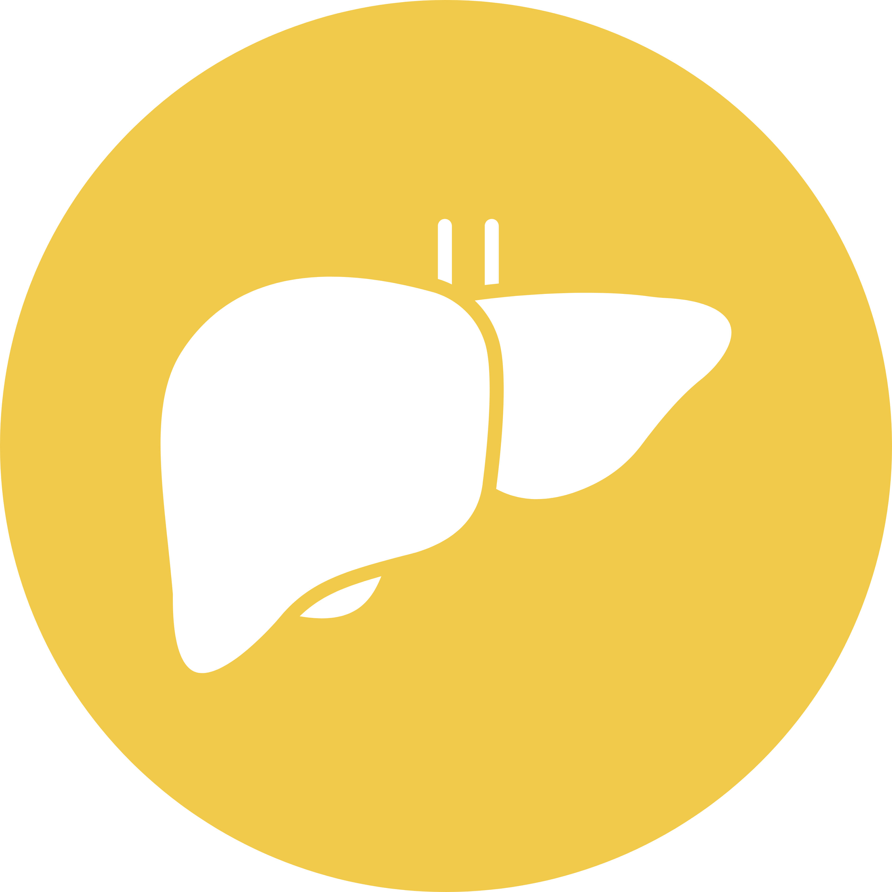
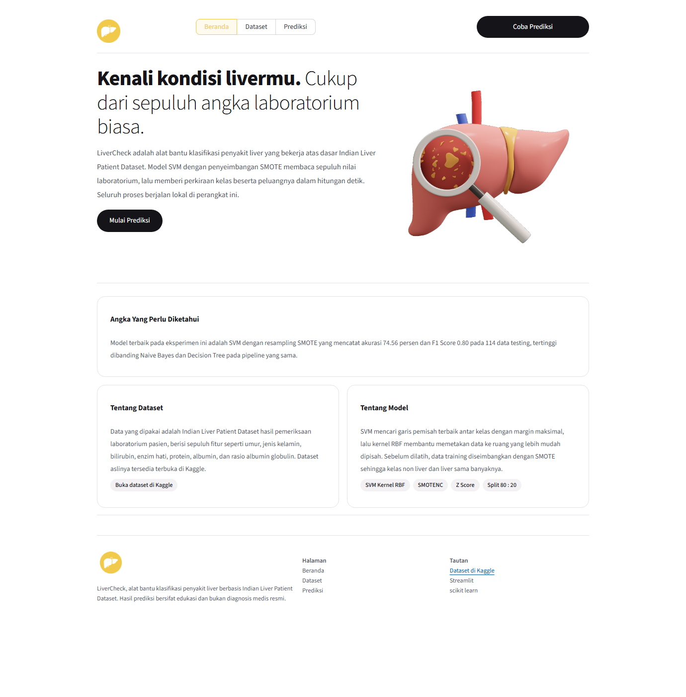
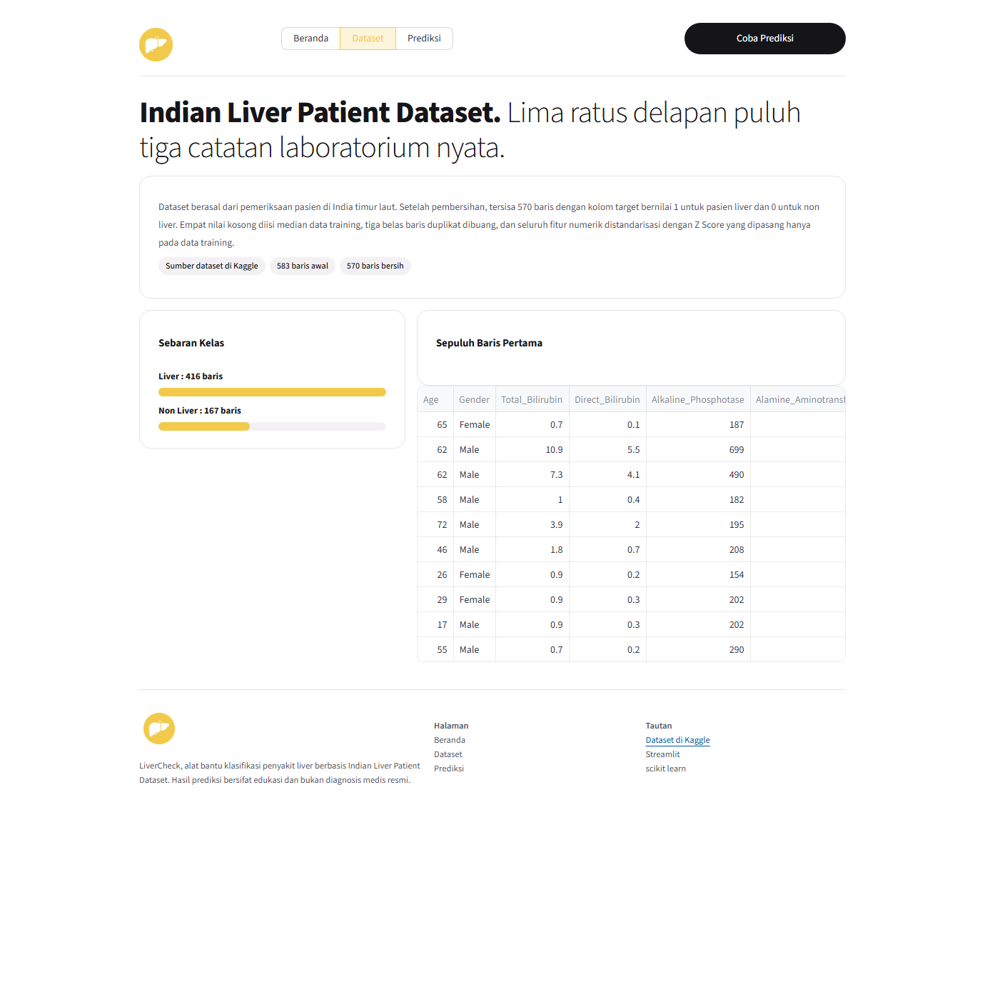
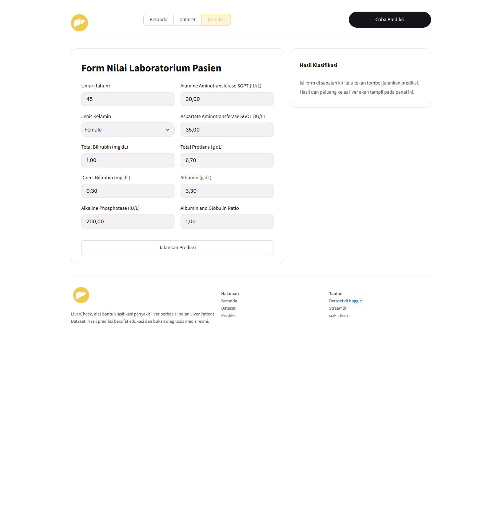
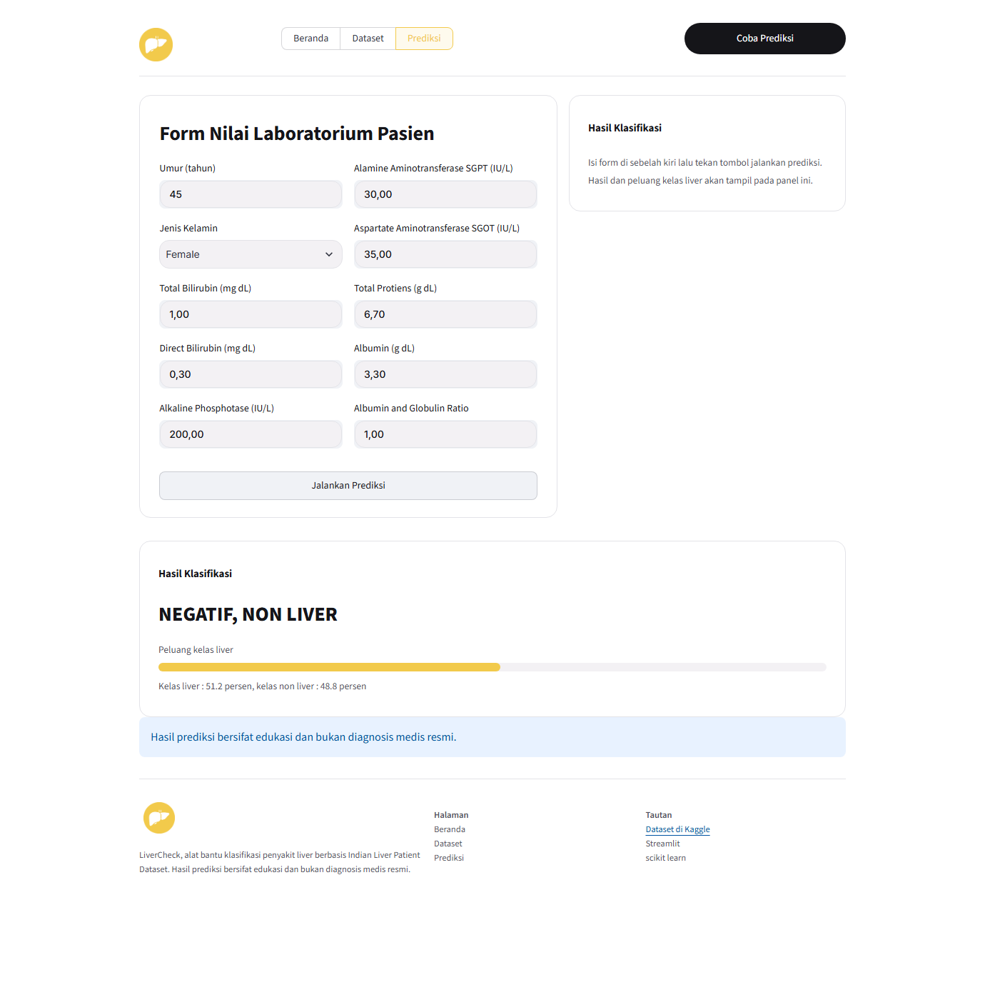

# LiverCheck

<p align="center">
  
</p>

Aplikasi klasifikasi penyakit liver berbasis **Indian Liver Patient Dataset (ILPD)** menggunakan **SVM (Support Vector Machine)** dengan penyeimbangan data **SMOTE**, dibangun dengan Python dan Streamlit.

## Tentang Proyek

LiverCheck memprediksi kemungkinan penyakit liver dari sepuluh nilai laboratorium pasien, yaitu umur, jenis kelamin, total bilirubin, direct bilirubin, alkaline phosphotase, SGPT, SGOT, total protein, albumin, dan albumin globulin ratio.

Model terbaik pada eksperimen ini adalah **SVM dengan resampling SMOTE** yang mencatat **akurasi 74.56 persen** dan **F1 Score 0.80** pada 114 data testing, tertinggi dibanding Naive Bayes dan Decision Tree pada pipeline yang sama.

## Dataset

Data berasal dari [Indian Liver Patient Records di Kaggle](https://www.kaggle.com/datasets/uciml/indian-liver-patient-records) berisi 583 catatan pemeriksaan pasien. Setelah pembersihan, tersisa 570 baris dengan kelas liver 414 dan non liver 156.

| | |
|---|---|
| Baris awal | 583 |
| Duplikat dibuang | 13 |
| Data training | 456 (325 liver, 131 non liver) |
| Data testing | 114 (81 liver, 33 non liver) |

## Pipeline

1. Preprocessing, hapus duplikat dan deteksi missing value serta outlier.
2. Split data 80 persen training dan 20 persen testing secara stratify.
3. Transformasi, imputasi median training, encoding Gender, dan standarisasi Z Score.
4. Resampling data training dengan ROS dan SMOTENC menjadi 325 berbanding 325.
5. Pelatihan tiga model, yaitu Naive Bayes, SVM, dan Decision Tree.
6. Evaluasi confusion matrix beserta akurasi, presisi, recall, dan F1 Score.

## Hasil Perbandingan

| Metode | Resampling | Akurasi | Presisi | Recall | F1 |
|--------|-----------|---------|---------|--------|-----|
| Naive Bayes | ROS | 57.02% | 1.0000 | 0.3951 | 0.5664 |
| SVM | ROS | 69.30% | 0.9107 | 0.6296 | 0.7445 |
| Decision Tree | ROS | 68.42% | 0.7586 | 0.8148 | 0.7857 |
| Naive Bayes | SMOTE | 64.91% | 1.0000 | 0.5062 | 0.6721 |
| **SVM** | **SMOTE** | **74.56%** | **0.9062** | **0.7160** | **0.8000** |
| Decision Tree | SMOTE | 67.54% | 0.7619 | 0.7901 | 0.7758 |

## Tampilan Aplikasi

### Halaman Beranda



### Halaman Dataset



### Halaman Prediksi



### Hasil Prediksi



### Heatmap Confusion Matrix


## Cara Menjalankan

```bash
pip install pandas numpy matplotlib seaborn scikit-learn imbalanced-learn streamlit joblib
```

Latih model dan hasilkan artefak:

```bash
python klasifikasi_nb_svm.py
```

Jalankan aplikasi:

```bash
streamlit run streamlit_app.py
```

## Struktur Proyek

```
├── streamlit_app.py          Aplikasi Streamlit
├── klasifikasi_nb_svm.py     Pelatihan dan perbandingan tiga metode
├── preprocessing.py          Pembersihan data
├── split_data.py             Pembagian data 80 : 20
├── transformation.py         Imputasi, encoding, dan Z Score
├── resampling.py             ROS dan SMOTENC
├── training.py               Pelatihan model
├── testing.py                Prediksi data testing
├── evaluation.py             Confusion matrix dan metrik
├── Dataset/                  Dataset ILPD
├── assets/                   Aset gambar aplikasi
├── docs/                     Dokumentasi gambar
└── model_terbaik.joblib      Model terbaik hasil pelatihan
```

## Disclaimer

Proyek ini bersifat edukasi untuk praktikum pembelajaran mesin dan bukan diagnosis medis resmi.
